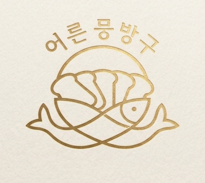
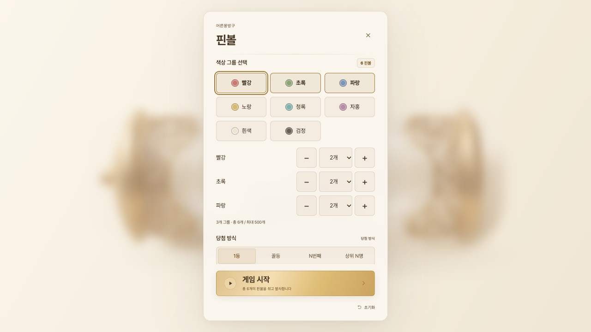
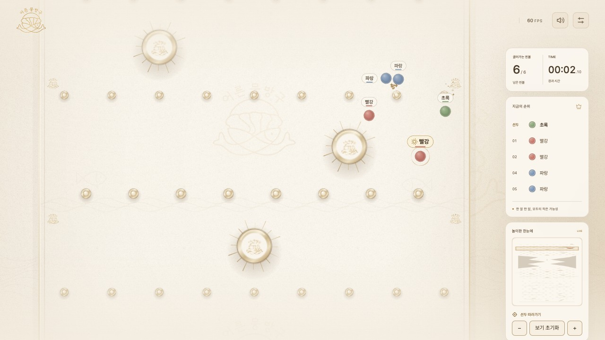
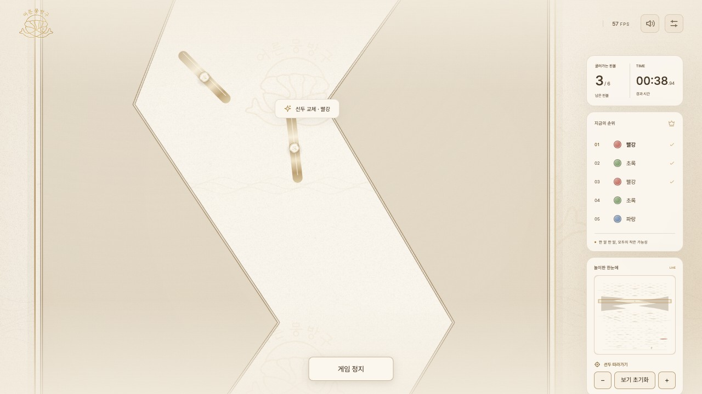
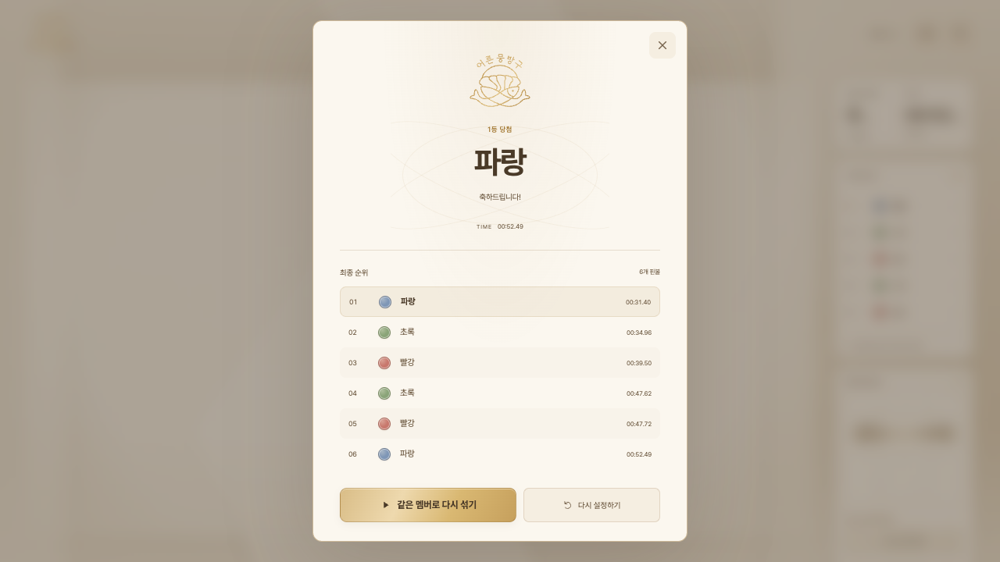

<p align="center">
  
</p>

<h1 align="center">어른뭉방구 · 핀볼</h1>
<p align="center">
  <a href="https://prestige-kim.github.io/moonbangoo_PinBall/"><strong>게임 시작하기 →</strong></a>
</p>

| 대기 화면 | 게임 진행 |
| :---: | :---: |
|  |  |

## 핵심 기능

- **네 가지 테마 코스** — 연못 정원·바람 도서관·빗살 협곡·태엽 공장을 서로 다른 배경과 지형으로 플레이합니다. [최신 맵 검토·배포 기록](docs/deployment-2026-10-15/REPORT.md).

현재 최대 공 개수는 **50개**입니다. [상한 변경·재검증 결과](docs/four-maps/MAX50.md).

- **직접 입력하는 그룹 설정** — 그룹 이름을 터치 키보드·외장 키보드로 입력하고, 그룹별로 8색 중 색상과 수량을 지정합니다. 그룹 추가·삭제와 기존 색상 선택 버튼을 지원합니다. 총 1~50개를 지원합니다.
- **4가지 추첨 방식** — 1등, 꼴등, N번째, 상위 N명을 선택합니다.
- **추월 기회가 있는 코스** — 연못 정원의 총 14개의 회전 장애물과 6개의 좌우 이동 게이트(갈대판 포함)를 배치했습니다. 맵 길이는 11,200이며, 결승은 11,000에 있습니다. 중간에는 폭이 928에서 320까지 좁아지는 지그재그 통로가 있고, 출구에서 다시 넓어집니다. 모든 공은 같은 장애물과 충돌하며 통과 시점에 따라 경로가 달라집니다.
- **직접 기울여 쏟고 섞기** — 공이 바닥에 놓인 유리관이 셔플관 위로 이동합니다. 단순 클릭은 반응하지 않으며, 오른쪽을 드래그하면 공과 관의 무게 중심을 기준으로 각도를 조절합니다. 충분히 기울이면 뚜껑이 열리고 공이 중력과 충돌에 따라 쏟아집니다. 공을 잡으면 모든 공이 손을 따라 움직이는 원 안에 모입니다. 원 안에서 공끼리 부딪히고 원 벽에서 튕기며 섞입니다. 손을 놓으면 원이 해제되고, 넓어진 오른쪽 위 출구로 끌어 발사합니다. 출구 안쪽의 발사 구역에서 “놓으면 발사!”가 표시되면 손을 놓아도 출발합니다. 빠르게 던질 필요는 없습니다. 발사 시 손의 출구 위치와 무관하게 맵 상단에 무작위로 흩어져 도착합니다. 기본 설정에서는 경기마다 새 시드를 사용합니다.
- **이어지는 카메라 연출** — 바퀴가 조립된 대포에서 오른쪽의 실제 놀이판으로 핀볼을 쏘고, 카메라가 핀볼을 따라 판 안으로 들어갑니다. 경기에서는 선두와 실시간 순위를 추적합니다.
- **그룹별 컬러 공** — 대기·섞기·발사·경기·결과에서 공 전체를 배경에 어울리는 부드러운 그룹 색으로 표시합니다. 은은한 반광 에나멜 질감과 고정된 표면 결을 사용하며, 색상과 식별 링을 유지합니다.
- **부드러운 선두 표시** — 순간적인 교차는 0.45초 동안 확인하고, 고정된 표시 행에서 부드럽게 갱신합니다. 완주 순위는 즉시 반영합니다.
- **첫 도착 후 경기 종료** — 첫 공이 결승에 도착하면 화면 하단에 **게임 정지** 버튼이 나타납니다. 누르면 남은 경기를 종료하고 도착한 공의 순위만 확인합니다. 꼴등·N번째·상위 N명 조건이 아직 충족되지 않았다면 당첨을 미확정으로 표시합니다.
- **결과 확인과 재시작** — 당첨자·도착 순위·경기 시간을 확인하고 같은 멤버로 다시 진행합니다.
- **화면과 속도 조절** — 확대·축소·보기 초기화·선두 따라가기 버튼, 드래그 이동과 터치 핀치를 지원합니다. 게임용 키보드 단축키와 휠 줌은 없습니다. 게임 속도, 효과음, 화질과 화면 효과 줄이기도 조절할 수 있습니다.

## 검증 상태

마우스·합성 터치 완주, 출발 기록·순위·완주 시간의 재현, 원형 벽의 공 유지와 화면별 레이아웃을 검사합니다. 실제 기기의 터치·성능 확인은 별도로 필요합니다. 원형 셔플은 실제 준비 단계 계산을 바꾸므로 **최종 참가자 공정성 holdout 검증은 아직 완료되지 않았습니다**. 공정성 합격을 보장하지 않습니다. [원형 셔플 검증 기록](./docs/interaction/CIRCULAR-GRAB.md)을 참고하세요.

## 이용 방법

1. **시작하기**를 누르고 그룹 이름을 입력하고 각 그룹의 색상과 핀볼 수량을 조절합니다.
2. 설정창에서 추첨 방식을 고른 뒤 **게임 시작**을 누릅니다.
3. 유리관이 셔플관 위로 이동하면 유리관 오른쪽을 아래로 드래그해 충분히 기울입니다. 공이 모두 흘러나오면 공을 잡아 원 안에서 드래그해 섞고, 오른쪽 위 출구 방향으로 밀어 발사하거나, “놓으면 발사!”가 표시된 구역에서 손을 놓습니다.
4. 첫 공 도착 후 **게임 정지**를 눌러 도착 결과를 바로 확인하거나, 모든 공이 완주할 때까지 기다려 최종 결과를 확인합니다.





출발 방식의 **매번 새로 섞기**는 경기마다 새 시드를 사용합니다. **직전 게임 재현**은 직전 시드와 그룹·수량·물리 설정 및 실제 출발 위치·속도를 복원하고 바로 경기를 시작합니다. 같은 버전과 실행 환경에서 같은 순위·도착 시간을 재현합니다. 출발 기록이 없거나 현재 검사에 맞지 않는 구버전·손상 기록은 재현할 수 없습니다. 새로 섞으면 새 출발 기록이 생성됩니다. 직전 설정과 출발 기록은 브라우저에 저장됩니다. 기존 설정은 그룹 이름·수량·순서를 유지하며 불러옵니다. 직접 입력한 이름과 색상은 함께 저장되며 직전 게임 재현 시에도 복원됩니다.

설치 없이 [브라우저에서 바로 실행](https://prestige-kim.github.io/moonbangoo_PinBall/)할 수 있습니다. PC에서는 내려받은 폴더의 `index.html`을 열어 오프라인으로도 이용할 수 있습니다.

<details>
<summary>개발 및 검증</summary>

HTML · CSS · JavaScript · Canvas 2D로 구현한 정적 웹 앱입니다. 외부 라이브러리나 빌드 과정이 필요하지 않습니다.

```sh
npm run qa
```

검증 범위는 [QA.md](./QA.md)를 참고해 주세요. GitHub Pages는 `main` 브랜치의 루트(`/`)를 자동 배포합니다. 별도의 빌드 없이 HTML·CSS·JavaScript와 로컬 에셋을 제공합니다.

로컬 미리보기는 저장소 루트에서 다음 명령으로 실행합니다.

```sh
python3 -m http.server 8765 --bind 127.0.0.1
```

브라우저에서 `http://127.0.0.1:8765/`를 엽니다.

</details>

### 대형 화면 선명도와 화면 맞춤

부드러운 선두권 카메라는 유지하고, 새로 추가했던 배경음악·징글은 제거했습니다. 기존 합성 효과음은 유지합니다. 맵 장식·장애물·미니맵의 표시 해상도를 화면 배율에 맞추며, 30Hz 화면을 저성능으로 오판해 품질 설정을 저장하지 않도록 변경했습니다. 확대된 브라우저의 옆 메뉴는 화면 높이 안에 맞추고 순위 영역을 스크롤할 수 있습니다. [기본 검증](qa/tv-display/README.md).

### 맵 상단 무작위 출발 (v2)

출구로 이동한 셔플 덩어리가 맵 우측에 몰려 투영되던 경로를 제거했습니다. 출발점은 별도 시드 스트림으로 맵 상단에 흩어지고 참가자에게 무작위 배정됩니다. 비행은 동일한 출발점에 도착하며 경기 RNG는 소비하지 않습니다. 재현 기록은 v2이며 기존 v1 기록은 새로 섞어야 합니다. TV 원본 4K에서는 맵을 크게 보여 주고 순위 패널의 불필요한 높이 확장을 막습니다. [검증·전후 캡처](qa/top-scatter/README.md). 우승 확률의 최종 holdout 공정성 검증은 아직 미완료입니다.

### TV 영상의 배경 띠·알갱이 수정

맵 위의 미세 노이즈와 CSS 노이즈를 제거하고, 화면에 고정된 부드러운 종이 질감으로 바꿨습니다. 배경 재질을 가시 구간의 직사각형으로만 채우던 경로를 맵 전체 채움으로 바꿔 이동 중 경계가 나타나지 않도록 했습니다. [영상 근거와 검증](qa/tv-background/README.md). 실제 TV 재확인은 남아 있습니다.

### 고해상도 성능 최적화

고정 종이 질감·비네트는 별도 레이어에 캐시하고, 경기 중 HUD 블러와 불필요한 버퍼 재생성·DOM 갱신을 줄였습니다. 프레임 지연이 반복되는 경우 경기 캔버스의 표시 해상도를 점진적으로 조절하며, HUD·고정 재질은 원래 해상도를 유지합니다. 안정적인30/60/120Hz 화면은 기본 해상도를 유지하고 사용자의 설정을 덮어쓰지 않습니다. 경기 계산과 출발/재현 프로토콜은 그대로입니다. [기본 성능 비교와 검증](qa/performance/README.md).

## 음악

대기·섞기·경기·결과 음악은 Kevin MacLeod의 CC BY 4.0 음원입니다. 곡별 출처와 편집 내용은 [음악 크레딧](music-credits.html)에서 확인할 수 있습니다. 음악은 시작하기 등 사용자 조작 후 재생되고, 음악·효과음 스위치와 볼륨을 함께 따릅니다. 다른 탭으로 이동하면 일시 정지됩니다.
