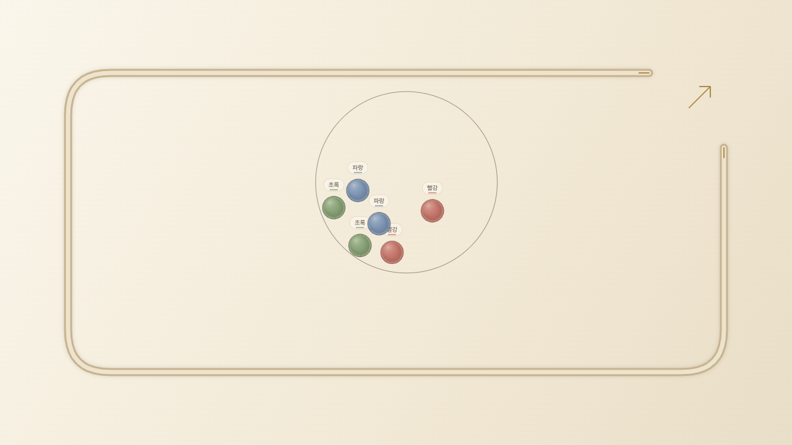
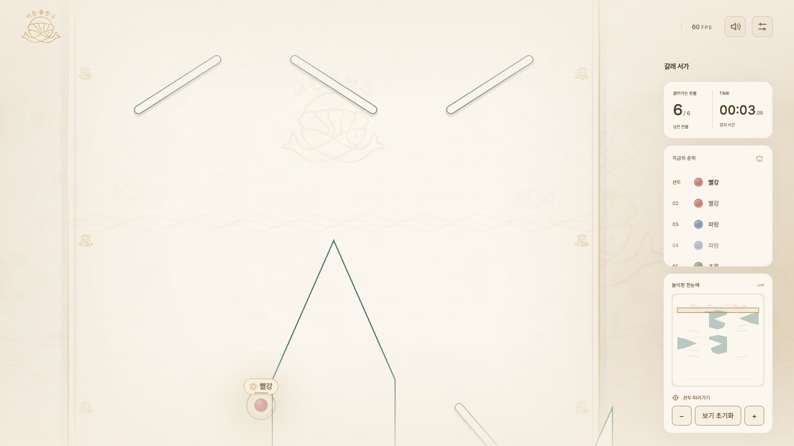
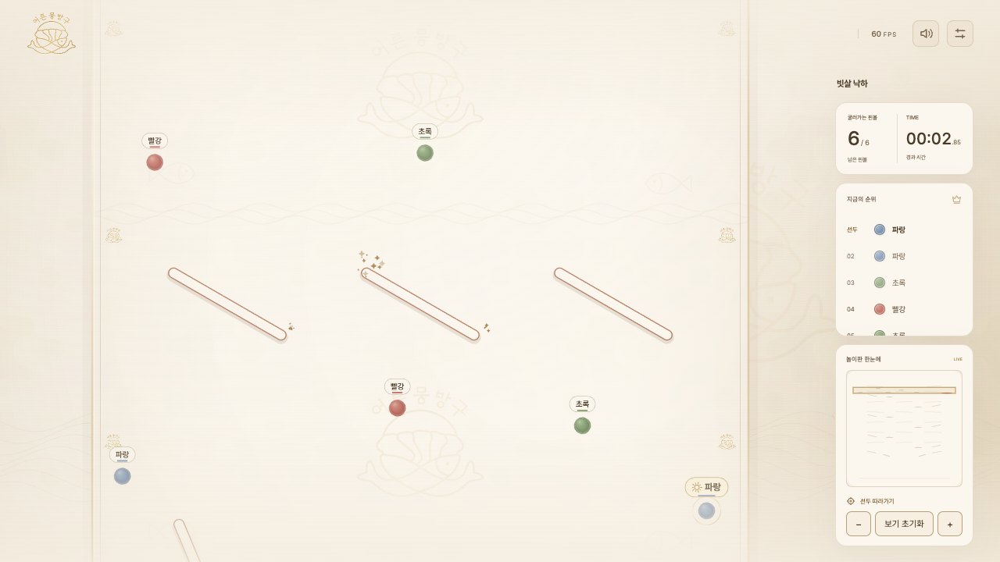
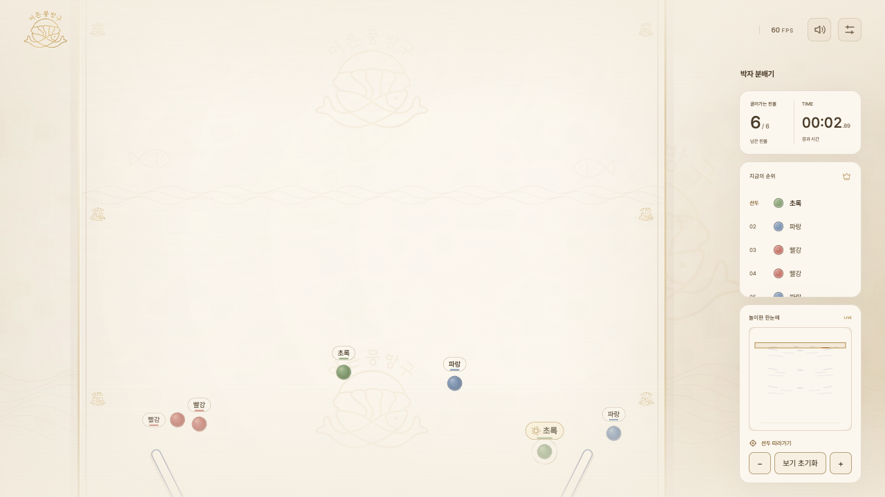

# 실제 배포본을 기준으로 맵 3종 통합

2026-10-14 확인 기준: https://prestige-kim.github.io/moonbangoo_PinBall/

실제 배포 HTML·모든 JavaScript·CSS·음원4개·저작권 안내, 총25개 파일을 다운로드하고 `origin/main`의 `5d25319ddd2d352cf35e314da27329c97daec397`과 SHA-256 및 내용 전체를 비교했다. **25개 모두 일치했다.** 이 배포 확인 커밋을 이번 통합의 기준으로 삼았다. [파일별 확인 기록](deployed/source-verification.json).

이전 로컬 main `db85b75`는 실제 배포본보다8개 커밋 뒤처져 있었다. 음원 브랜치 `codex/pinball-music`, 전환 개선 `codex/smooth-music-transitions`는 남아 있고 배포본에 반영돼 있었다. 두 번의 이전 통합에서 잘못된 로컬 기준을 사용한 이력은 보존하되 현재 기능 보존 근거로 사용하지 않는다.

## 기존 기능 보존

배포본의 핵심 공통14개 파일과 음원4개·저작권 페이지5개를 고정 해시로 검증한다. `tests/fixtures/preserved-main-sources.json`에 실제 배포 확인 기준과 해시를 기록했고, `tests/preserved-main.test.cjs`가 통합 코드의 일치를 검사한다.

- 원형 셔플 포집·원 벽 반사, 유리관 붓기, 발사, v2 출발 기록: 배포본과 동일.
- 카메라 선두 표시 수정·버튼·화면 품질·적응형 렌더링: 배포본과 동일.
- 음원4개와 audio.js: 배포본과 동일. 설정/셔플·비행/경기/결과의 장면 연결, 준비 상태를 기다리는 크로스페이드, 음소거·볼륨·탭 가시성 동작을 유지.
- 그룹·추첨4종·순위·정지·재시작·결과 홈 링크·음원 저작권 안내를 유지.
- main.js의 배포본 대비 변경은 맵 ID 정상화, 신규 맵 정책, renderer의 맵 설정, 결과 맵 이름 전달뿐이다. 음악 장면 연결과 visibility 음악 동기화는 그대로다.

기본 maps.js와 물리 상수는 유지한다. physics.js 변경은 신규 맵에서만 스킬·힘을 추가하는 막힘 방지를 차단하는 정책이다. 공통 UI와 renderer에 맵 선택·이름·미니맵·전용 스타일을 추가한다. 신규 데이터/스타일은 js/maps/의 독립 파일이다. 맵별 시간 안내는 맵 추가 요청에 따라 기존 로컬 시간 안내 작업을 보존·확장했다.

기본 맵의 스킬 선택은 신규 맵을 거쳐 돌아와도 복원하며, 이미 선택된 맵을 다시 누르면 직전 시드가 유지된다. 실제로 다른 맵을 선택할 때만 해당 출발 기록 연결을 해제한다.

## 검증

**전체 테스트256개 통과/실패0.** 배포본에는 기존 카메라 검사2개를 해결한 `84c8fe9`가 포함돼 있어 이전 통합에서 남았던 실패도 해소됐다. 전체 로그: qa/four-maps/results/deployed-tests.txt.

셔플/발사/hand-start와 기본 지형은 직전 검증 버전과 동일하므로, 72건의 실제 손 출발·완주·정확 재현과 독립2700건의 탐색 공정성 증거는 유지된다. 실제 배포 기준의 신규 브라우저 결과는 아래 기록에 추가한다. 소표본 공정성은 보장이 아니며 엄격한1.5%p 최대 편차 기준은 아직 충족하지 못한다. 실물 휴대폰은 검증하지 않았다.

이전 보고서 REPORT.md와 REINTEGRATION.md는 과거 기준의 기록이다. 현재 완료 상태는 이 문서를 따른다.

## 로컬 사용과 이력

브랜치: codex/four-maps-local. 이전 작업과 기존 미커밋 감사 파일3개는 보존했다. 음원·전환·카메라 개선을 포함한 배포 커밋의 이력을 로컬 맵 브랜치에 통합했다. 원격 push·PR·main 변경·배포는 하지 않았다. 최종 통합 커밋 SHA는 완료 응답에 제공한다.

로컬 미리보기: http://127.0.0.1:8765/ . 새로고침 후 시작 버튼을 누르면 브라우저의 사용자 입력을 통해 음원 재생이 시작된다. 소리 설정이 꺼져 있으면 켜서 확인한다.

재실행:

```sh
cd /Users/proudchris/Desktop/moonbangoo_PinBall
python3 -B -m http.server 8765 --bind 127.0.0.1
```

종료는 해당 서버 터미널의 Ctrl+C. 검사는 `npm test`, 브라우저 검사는 `node qa/four-maps/browser.cjs`. 실행 결과는 qa/four-maps/results/deployed-browser/에 남는다.

### 실제 브라우저 최종 결과

네 맵 모두 설정의 Chipper Doodle v2, 셔플의 Electrodoodle, 경기의 Bit Quest, 결과의 Winner Winner!를 확인했다. 총16개 장면에서 실제 HTMLAudioElement의 재생 상태, 디코딩 readyState≥2, 양수 currentTime을 검사했다. 네 맵에서 음소거 시 모든 플레이어 정지 및 재개를 확인했고, 실제 원형 셔플·발사·결과·직전 경기 정확 재현·재시작을 통과했다. JavaScript 오류0.

폭360/390/768/1280/1920에서 레이아웃·입력 확인을 완료했다. 작은 화면은 터치 에뮬레이션이다. 신규 맵200/500개 각각 발사 후6초 관측에서 고화질60FPS였으며 소표본 관측이다. 전체 테스트256/256, 음원·통합·해시 보존 재확인40/40 모두 통과했다.

[현재 브라우저 결과·음원 상태·재현 기록](deployed/browser-report.json)에 상세 측정치를 저장했다. 실제 재생 API와 디코딩 진행을 검사했으며 실물 기기의 스피커 청취 검증은 아니다.





