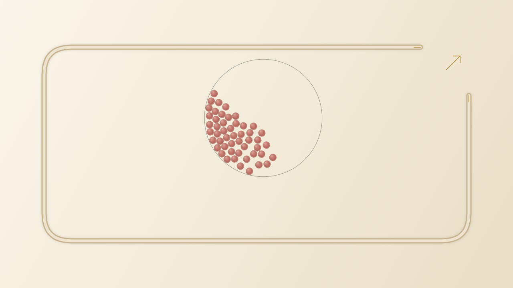
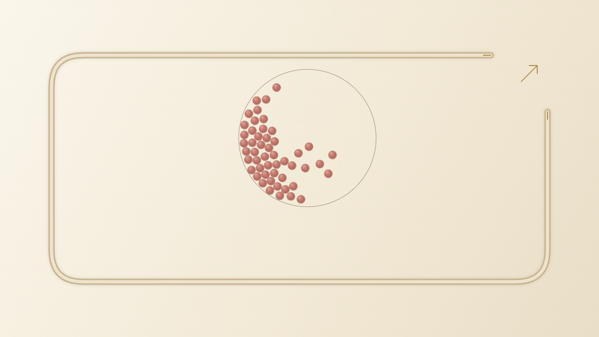
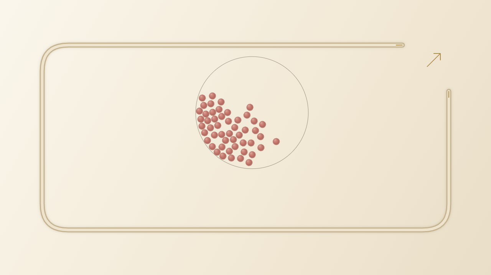

> 최대50개 제한은 유지합니다. 이후 지형·배경 개편의 최신 결과는 [PERSONALITY.md](PERSONALITY.md)를 확인하세요. 아래는 개수 상한 변경 당시의 기록입니다.

# 공 개수 상한 50개 변경·재검증

2026-10-14. 변경 전 로컬 기준은 배포본5d25319에 네 맵과 음원을 통합한 a60111c다. 기존 작업과 감사 미커밋 파일을 유지하고, 공 개수 상한과 이에 필요한 설정·검사만 변경했다.

## 적용

- 공통 `P.MAX_MARBLES=50`. 이름 해석, 여러 그룹 합계, Physics 생성에서51개 이상을 거부한다.
- 그룹 추가·수량 증가·드롭다운과 당첨 순위 선택은 총50개에 맞춘다. UI를 우회한51개 입력도 경기 생성 단계에서 거부한다.
- 기존 저장 설정이50개를 넘거나 유효하지 않으면 기본6개로 복원하고 화면에서 안내한다. 맵·물리·소리 설정은 유지하고, 해당 시드와 출발 기록 연결은 해제한다. 50개 초과 직전 경기 기록은 재현 대상으로 사용하지 않는다. 조용히 참가자를 잘라내지 않는다.
- 시간 안내는50개 이하의 측정 표본만 사용한다. 과거200/500개 원시 측정은 역사 기록으로 유지한다.
- 음원4개와 전환, 셔플 원형 벽, 발사, 맵 지형, 물리 상수, 카메라·화질·구슬 스타일은 변경하지 않았다. 고정된 배포본 해시 보존 검사가 계속 통과한다.

## 검증 결과

전체 테스트 **259개 통과/실패0**. 기존 정상 실행 검사의 개수 조합을 지원 범위1/2/6/25/49/50로 갱신하고, 별도로51·500개 입력 거부, 여러 그룹 합계51, 직접 Physics51, 큰 저장값 복원, 잘못된 경기 시작 거부를 추가했다. 기존 검사의 충돌·재현·소리·카메라·연출 조건을 유지했다.

네 맵 ×6개수 ×기본값 및8개 물리 모서리 조합 ×2시드 = **432건, 실패0**. 반지름8/16·중력350/1500·반발력.35/.92 조합을 사용했다. 240 물리초 안에 전원 완주했으며 누락·중복·비정상 좌표·벽 이탈·검사 대상 장애물 관통을 검사했다. 기본 맵의 원래 막힘 방지는 허용하고 신규 맵의 힘 추가는 금지했다. 타임아웃 표본을 제외하지 않았다.

| 맵 | 기본 설정50개 2회 완주 시간 | 전체 경계 조합 최대 시간 | 실패 |
|---|---:|---:|---:|
| 기본 자개 핀 보드 | 52.100 / 61.342초 | 210.242초 | 0 |
| 갈래 서가 | 24.542 / 23.375초 | 58.983초 | 0 |
| 빗살 낙하 | 25.925 / 29.250초 | 68.333초 | 0 |
| 박자 분배기 | 24.242 / 27.017초 | 49.033초 | 0 |

시간은 준비·발사 제외, 물리 시간이다. 기본 맵의 극단 설정은 여전히 길어질 수 있으며 상한을 낮춘 것으로 경기 시간 단축을 보장하지 않는다.

**변경 전후48건의 순위·도착 시간·완주 여부가 정확히 일치했다.** a60111c의 원본JS를 별도 임시 폴더에서 실행한 결과와 현재 코드를 비교했다. 같은 시드·1/2/6/25/49/50개·각 맵·스킬 요청 켬/끔을 비교했으며 신규 맵의 스킬 금지 정책도 유지된다. [비교 기록](max50/parity.json).

브라우저와 성능의 최종 결과는 검증 완료 후 아래에 기록한다. 소표본은 모든 장비·시드의 무결함을 보장하지 않으며 실물 휴대폰 검증은 별도다.

## 재검증·로컬 실행

```sh
npm test
node qa/four-maps/max50.cjs
node qa/four-maps/browser.cjs
node qa/four-maps/performance.cjs
```

http://127.0.0.1:8765/ 에서 새로고침하면 최대50개 설정을 확인할 수 있다. 서버 재실행은 프로젝트 폴더에서 `python3 -B -m http.server 8765 --bind 127.0.0.1`, 종료는 서버 터미널의 Ctrl+C.

로컬 브랜치는 codex/four-maps-local이며 최종 커밋 SHA는 완료 응답에 제공한다. 원격 push·PR·병합·배포 없음.

## 최종 브라우저·성능 결과

네 맵 모두 실제50개로 붓기→원형 셔플→발사→결과→정확 재현·재시작을 완료했다. UI의 총50개 표시, 증가 버튼 잠금, 위조된51개 수량 변경 거부, 기존500개 저장값의 안내·6개 복원·직전 재현 비활성화를 확인했다. 네 맵의 설정·셔플·경기·결과 음원 실제 로딩/재생과 음소거 복귀도 통과했다. JavaScript 오류0.

폭360/390/768/1280/1920에서 실제50개 입력·발사·경기를 확인하고 가로 넘침0을 확인했다. 작은 화면은 터치 에뮬레이션이며 실물 휴대폰은 별도다. 각 맵50개 경기의6초 관측에서 고화질60FPS였다. 이는 한 장비의 관측이며 모든 장비의 최소 FPS 보장은 아니다.

다른 검증이 끝난 뒤 각 맵50개×5시드 직렬로 물리 step p95를 측정했다. 모든 표본이 완주했고 비용과 환경은 [summary.json](max50/summary.json)에 보관했다. 실제 브라우저 출발 기록·순위·음원 상태,432건 집계도 같은 파일에 포함했다. 50개 지원 범위에서 새 게임 오류나 시각 품질 저하는 관측되지 않았다.





