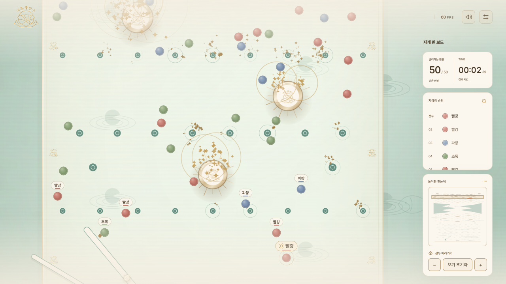
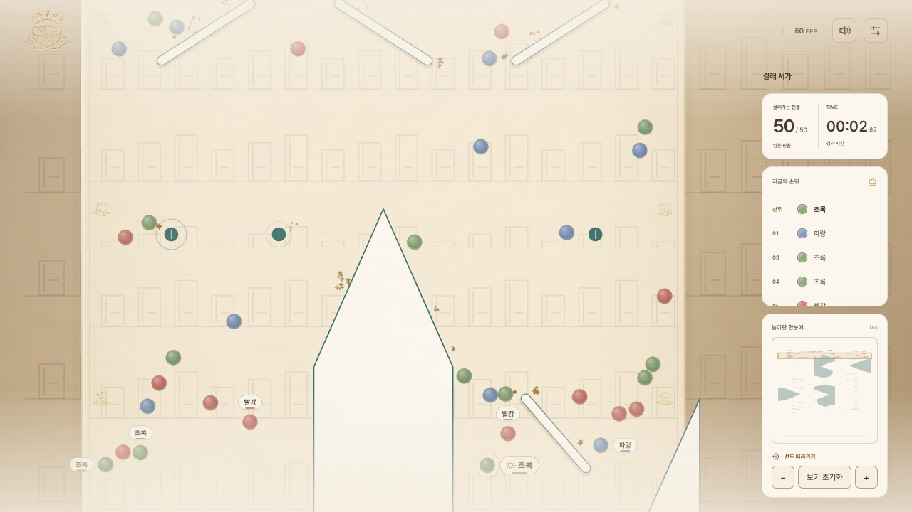
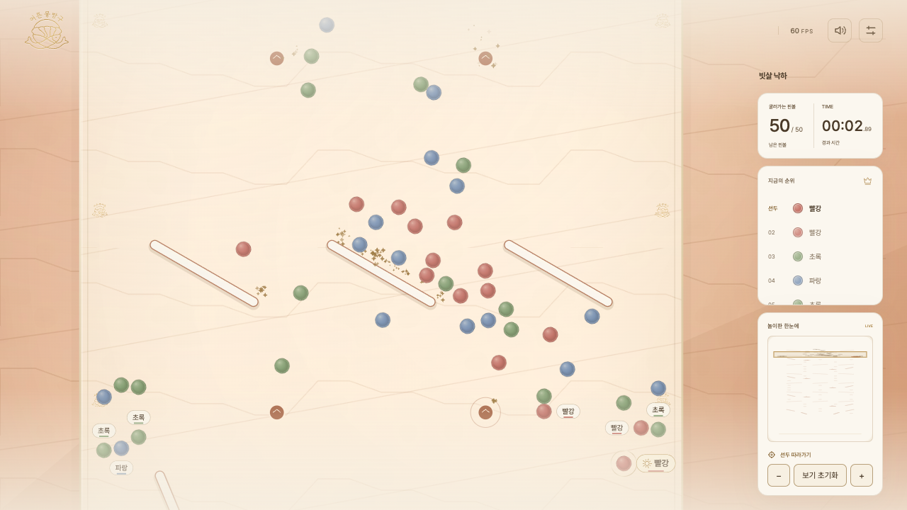
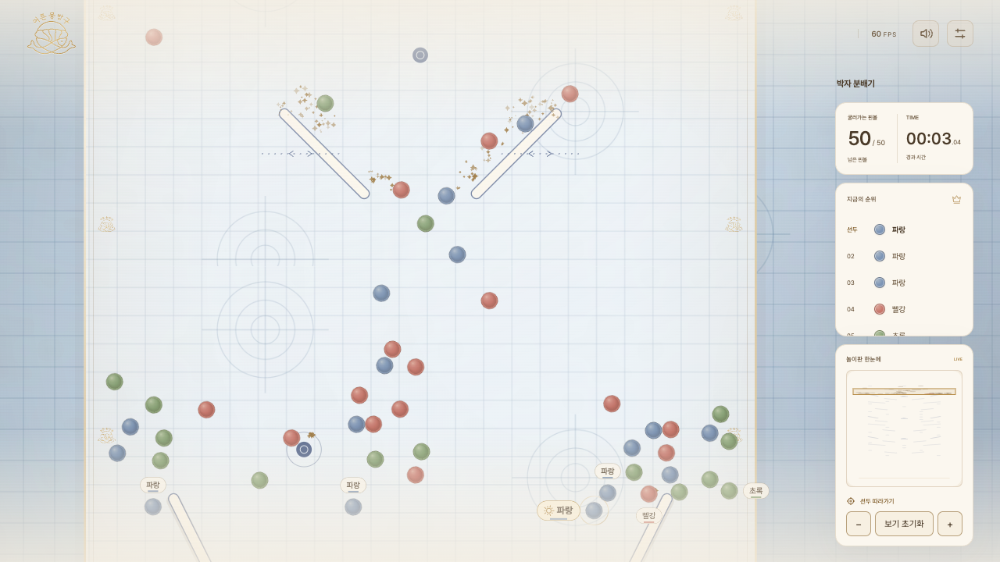

# 네 맵 배경·장애물 개편

2026-10-14. 기준은 배포본5d25319에 맵3종·최대50개와 시간 안내 제거를 반영한 b544a19다. 사용자가 모든 맵의 개성과 상호작용 보강을 요청해 이번에는 기본 맵을 포함한 지형도 의도적으로 확장했다. 기존 변경·감사 파일과 이전 검증 기록을 보존했다.

## 맵별 구현

| 맵 | 배경·판 무늬 | 추가한 기능 | 장애물 수 |
|---|---|---|---:|
| 자개 핀 보드 | 옥빛 연못, 수련·물결 타원, 연녹색 판 | 기존 핀·회전판을 유지하고15개 충돌 핀과2개 느린 갈대 이동판 추가 | 268 →285 |
| 갈래 서가 | 호두빛 책장, 책등·선반 반복 무늬, 따뜻한 종이 판 | 두 번의 분기·합류를 유지하고32개 핀으로 경로를 재분산 | 18 →50 |
| 빗살 낙하 | 노을빛 산층, 계단·지층 무늬, 살구색 판 | ±30° 선반18개 사이에36개 핀을 분산해 연속 충돌·낙하 유도 | 36 →72 |
| 박자 분배기 | 푸른 청사진, 격자·동심원 무늬, 청백색 판 | 이동 막대6개→14개, 공방 핀28개 추가 | 21 →57 |

캐시된 Canvas 배경·판 타일을 구현했다. 맵 변경 시 배경을 다시 만들고 판 타일 캐시 키에 맵을 포함한다. 핀의 화면 외곽은 실제 충돌 반지름과 일치하며 책등·계단·링 형태의 표시를 달리한다. 충돌 시 기존 hit 이벤트에 반응하는 작은 링으로 상호작용을 보여준다. 그룹별 공 색·식별 표시는 유지한다.

추가 지형은 명시적인 고정 좌표이며 실행 중 무작위로 생성하지 않는다. 갈래 서가의 분기와 빗살 낙하의6단 구조는 그대로다. 박자 분배기에는 y1400/3500/5800/8200에 기존과 같은 길이160·진폭55·속도.8rad/s의 반대 위상 막대 쌍을 더했다. 기본 맵 갈대2개는 y8875, 길이120, 진폭40, 속도.8, 경사±30°다. 신규 맵의 마지막 y8800~11000은 장애물 없는 열린 구간을 유지했다.

추가 핀은 일반 충돌만 사용하고 부스트·순위·ID·그룹 보정을 추가하지 않았다. 신규 맵의 랜덤 스킬·강제 막힘 방지 금지는 유지했다. 신규 지형 버전은 classic2 / twinfold4 / cascade3 / rhythm2다. 이전 지형의 출발 기록은 재현 서명 검사에서 거부되며 새로 섞어야 한다. 현재 지형의 재현은 정확히 검증했다.

## 실제 상호작용 비교

변경 전후 동일한8시드/맵,50개,기본 물리 설정을 직접 실행해 물리 엔진의 hit/bumper 이벤트를 집계했다. 화면에 이벤트를 별도로 만들어낸 수치가 아니다.

| 맵 | 이전 평균 충돌 | 현재 평균 충돌 | 증가 |
|---|---:|---:|---:|
| 기본 | 2370.375 | 2483.125 | 약4.8% |
| 갈래 서가 | 353.625 | 515.000 | 약45.6% |
| 빗살 낙하 | 365.750 | 500.375 | 약36.8% |
| 박자 분배기 | 195.750 | 403.500 | 약106.1% |

한 공이 같은 장애물을 여러 번 만나면 여러 이벤트로 집계된다. 접촉한 고유 장애물 수와 추가 지형의 실제 충돌 수도 [summary.json](personality/summary.json)에 함께 저장했다. 표본 밖 모든 시드에서 같은 증가율을 보장하지는 않는다.

## 검증과 수정

- 전체 테스트261개 통과/실패0. 기존 기본 맵의 지형은 새 추가분을 제외했을 때 원본 해시와 같으며, 원본 출발 기록·완주 결과를 그대로 감사할 수 있다. 실제 개편 맵에는 그 옛 기록을 잘못 적용하지 않는다.
- 네 맵1/2/6/25/49/50개 ×기본값 및 반지름8/16·중력350/1500·반발력.35/.92의8모서리 조합 ×2시드 =432건, 최종 실패0. 타임아웃240초를 유지했다.
- 갈래 서가·빗살 낙하·박자 분배기의 장애물 전체와 벽 사이를 검사했다. 최소 간격은106 /101.675 /100.863이며, 핀 반지름과 이동 막대의 전체 주기961시점을 포함했다. 기본 맵의 원래 밀집 지형은 이 신규 맵96간격 조건의 대상이 아니다.
- 실제 B/C/D 손 출발72건의 완주·정확 재현 통과. 기본 맵의 기존 후반 추월 검사도 조건을 완화하지 않고 통과했다.
- 네 맵에서50개 실제 붓기·원형 셔플·음원4장면·경기·결과·재현·재시작을 확인했다. JavaScript 오류0. 폭360/390/768/1280/1920의 입력·레이아웃과 고화질60FPS 관측을 기록했다. 실물 휴대폰은 별도다.

검사 중 기본 맵의 낮은 중력·높은 반발력 조건에서20° 갈대판 주변에 마지막 공이 오래 튀는240초 초과 사례를 발견했다. 경사를30°로 조정해 같은 조건이176.008초에 전원 완주했고,432건과 전체 회귀 검사를 다시 실행했다. 원시 실패 증거는 qa/four-maps/results/personality-before-reed-fix.json에 보존했다. 실패를 타임아웃 표본에서 제외하거나 완주 처리하지 않았다.

새 지형을 고정한 후 독립 series personality 시드로 신규 맵당300회×B/C/D,총2700회 편향 탐색을 수행했다. 완주 실패0, 모든 ID·그룹 p≥.01 탐색 기준 통과. 엄격한1.5%p 편차 기준은 대부분 충족하지 못했으며 공정성 인증은 아니다.6개·균등3그룹·첫 당첨자 범위의 검사이고50개·불균등 그룹·모든 규칙의 공정성을 보장하지 않는다. 개발 결과로 최종 시드를 조정하지 않았다.

## 실제 화면

## 로컬 실행

http://127.0.0.1:8765/ 에서 새로고침하면 개편본을 확인할 수 있다. 최대50개, 원형 셔플, 음원·전환, 그룹·추첨4종·정지·재시작, 제거된 예상 경기 시간 문구 상태를 유지한다. 원격 push·PR·배포는 하지 않았다.

검사: npm test, node qa/four-maps/max50.cjs, node qa/four-maps/restored-check.cjs, node qa/four-maps/browser.cjs, node qa/four-maps/performance.cjs. MAP_ONLY=classic은 기본 맵만 재검증한다. 원시 결과는 qa/four-maps/results/에 보관하고 선택한 집계·스크린샷은 이 문서 옆에 저장했다. 서버 재실행은 python3 -B -m http.server 8765 --bind 127.0.0.1, 종료는 해당 터미널의 Ctrl+C다.

각 맵50개×5시드를 다른 검사 종료 후 직렬 실행한 물리 step p95와 실행 환경도 summary.json에 포함했다. 이 비용은 브라우저 전체 프레임 시간이 아니며 스크린샷/FPS 관측과 구분한다. 새 무늬는 정적인 배경·타일 캐시에 그려 화면 효과 줄이기에서도 지형의 실제 동작이 바뀌지 않는다.
