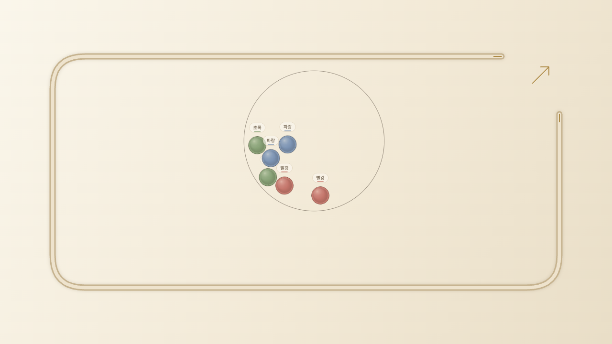
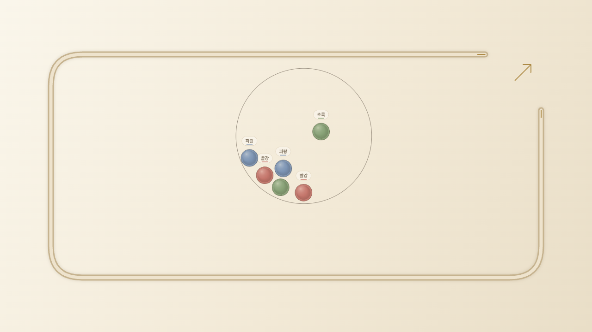
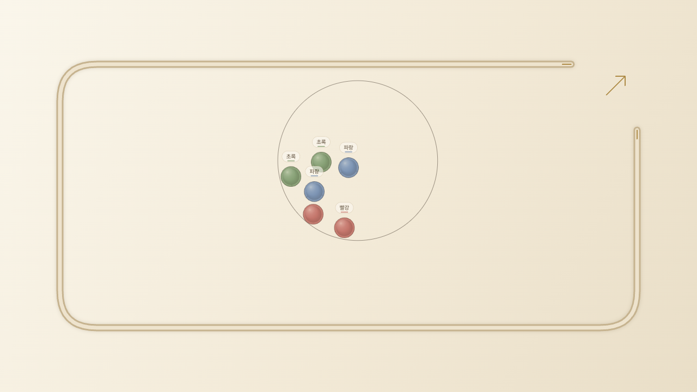
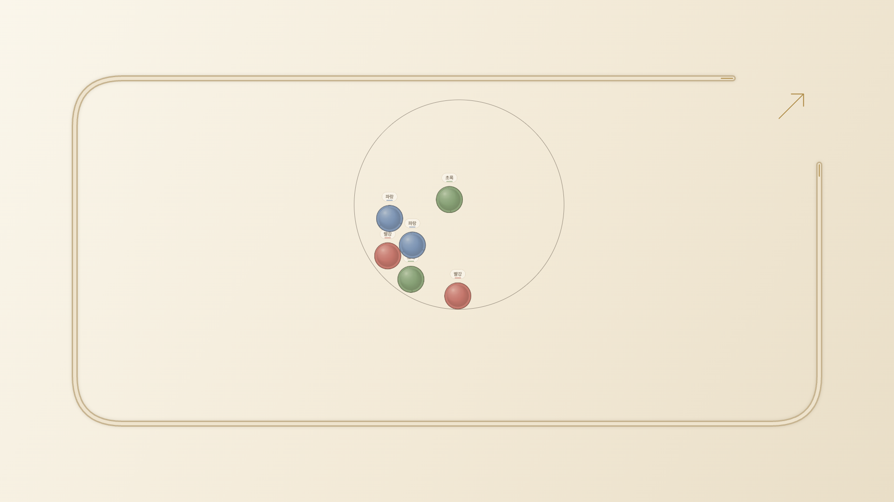

# 기존 기능 복원 후 맵 3종 재통합

복원 기준은 맵 추가 이전의 기존 기능을 포함한 `main` 커밋 `db85b75`다. 앞선 맵 개발 기준 `8362f84`는 원형 셔플 등 이후 기능이 없는 분기였으며 이 기준으로 한 보존 판정은 잘못됐다. `cffd300`까지의 맵 개발 이력과 기존 미커밋 감사 파일을 남기고, 현재 `codex/four-maps-local`에 기준 기능을 통합했다. main 자체를 수정하거나 원격에 push·병합·배포하지 않았다.

## 보존 범위

다음 14개 파일은 db85b75의 내용과 바이트 단위로 동일하다. `tests/fixtures/preserved-main-sources.json`에 고정한 SHA-256을 `tests/preserved-main.test.cjs`가 검사한다.

- 기본 지형: maps.js
- 원형 셔플·붓기·발사·재현: shuffle.js, shuffle-input.js, hand-scene.js, hand-flight.js, throw-gate.js, hand-start.js, cinematic.js
- 카메라·순위·소리·효과·테마·표시 성능: camera.js, race-standing.js, audio.js, effects.js, themes.js, display-budget.js

공통 physics.js는 신규 맵에서만 스킬·강제 막힘 방지를 차단하는 기존 맵 정책 변경만 남는다. UI/main/renderer에는 맵 등록·선택·저장·맵 이름·맵별 스타일·정책을 연결한다. 기본 렌더링에는 기존 소재 캐시, 선명도, 막대 잔상 제거, 적응형 렌더링을 유지한다. 카메라 버튼과 결과 로고도 기존 버전을 유지한다. 작업 전 미커밋 기능이었던 시간 안내와 결과 홈 링크도 삭제하지 않았다.

맵 전환 시 기본 맵의 스킬 선택은 `classicSkills`로 보존하고 새로고침 후 돌아와도 복원한다. 이미 선택된 맵을 다시 누르는 동작은 아무 설정도 바꾸지 않는다. 다른 맵으로 바꾸면 기존대로 출발 기록 연결을 해제한다.

## 검증 기준

- 원형 셔플 기존 테스트(6/50/200/500개, 원형 벽 반사, 손 이동, 속도 전달, 표시 주기 독립성)를 다시 실행한다.
- db85b75 원본 JS만 별도 임시 폴더에 읽어 B/C/D 실제 출발 기록 v2와 완주 결과를 먼저 만든 뒤, 통합 코드에서 그 기록의 정확한 순위·도착 시간을 비교한다. fixture는 `classic-preserved-main.json`이며 이전 v1 fixture는 과거 기록으로 보존한다.
- 4맵 × 1/2/6/50/200/500개 × B/C/D =72 실제 출발·완주·정확 재현 사례를 검사한다.
- 브라우저에서 기본 포함4맵의 원형 벽 포집을 실제 마우스 입력으로 검사하고 화면을 저장한다. 설정 지속성, 동일 맵 재선택, 재현, 재시작, 다섯 화면 폭, 터치 에뮬레이션도 확인한다.
- 기존 전체 테스트를 실행하고, 실패가 있으면 변경 전 기준에서도 동일한지 별도 확인한다. 기준에서 실패한 테스트를 삭제하거나 완화하지 않는다.

이전 v1 손 출발·공정성 수치는 현재 버전에 전용하지 않는다. 지형은 수정하지 않았으므로 지형 단독 경계 조합과 간격 증거는 유지한다. 새 공정성 확인은 사전 등록한 `restored-v2` 별도 시드300회×B/C/D×3맵으로 실행한다. 소표본 탐색이며 엄격한 공정성 인증이 아니다.

## 로컬 사용

http://127.0.0.1:8765/ 에서 새로고침하면 복원된 코드가 로드된다. 스크립트 캐시 키를 현재 파일 해시로 갱신했다. 서버 재실행은 프로젝트 폴더에서 `python3 -B -m http.server 8765 --bind 127.0.0.1`, 종료는 해당 터미널의 Ctrl+C다.

## 실행 결과

- 보존·원형 셔플·기본 맵 v2 재현 관련 9개 테스트 모두 통과. 원형 벽 반사를 포함한 기존 원형 셔플 테스트 5개가 복원 후 통과했다.
- 전체 테스트 244개 실행: 최초240 통과/4 실패. 2개는 기존 화질 정책의 지연 시간과 사용자 설정 보존을 반영하지 못한 테스트였다. 제품 코드를 변경하지 않고 기대값을 현재 기준 정책에 맞춘 뒤 통합·맵 통합·소스 보존32개를 다시 실행해 전부 통과했다.
- **카메라 추적 검사2개는 남아 있다.** db85b75 원본만 별도 경로에 놓고 실행해 동일한 실패(좁은 화면 선두 경계, 고속 경기 빈 화면406프레임)를 확인했다. 현재 작업은 기존 카메라 코드를 바이트 단위로 유지한다. 이 실패를 고치기 위해 기존 동작을 별도로 변경하거나 테스트를 지우지 않았다. 원본 결과: [baseline-camera-failures.txt](restored/baseline-camera-failures.txt).
- 72개 실제 손 출발·완주·정확 재현 사례 실패0. 신규 맵에서 금지된 스킬/막힘 방지 힘 이벤트0.
- 신규 독립 공정성 표본2700개 완주 실패0, 모든 B/C/D의 ID·그룹 p≥.01 탐색 기준 통과. **1.5%p 최대 편차 기준은 여전히 충족하지 못했으며 공정성 보장은 아니다.** 표본 범위는6개 구슬·균등3그룹·첫 당첨자다.

원시 로그는 `qa/four-maps/results/restored-*.txt/json` 및 `fair-restored-v2-final-*.json`에 보관한다. 현재 집계는 [restored/summary.json](restored/summary.json)에 저장한다. 예전 REPORT.md의 v1 결과와 구분한다.

브라우저 확인도 완료했다. 네 맵 모두 실제 붓기→원형 셔플→발사→결과→정확 재현·재시작을 통과했고 JavaScript 오류0이었다. 기본 스킬 선택의 맵 전환·새로고침 보존과 같은 맵 재선택 시 직전 시드 보존도 통과했다. 폭360/390/768/1280/1920에서 가로 넘침 없이 실행했고 작은 화면에서는 터치 에뮬레이션을 사용했다. 실물 휴대폰 검증은 하지 않았다. 200/500개 브라우저 관측은 다른 CPU 검증과 동시 실행했으므로 성능 비교 벤치마크로 사용하지 않는다.
