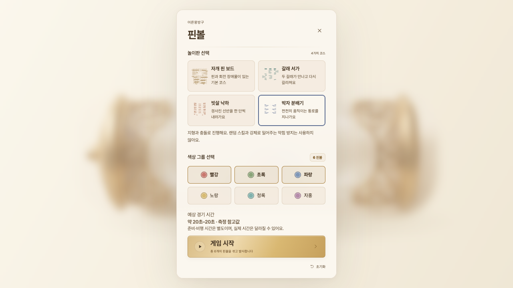
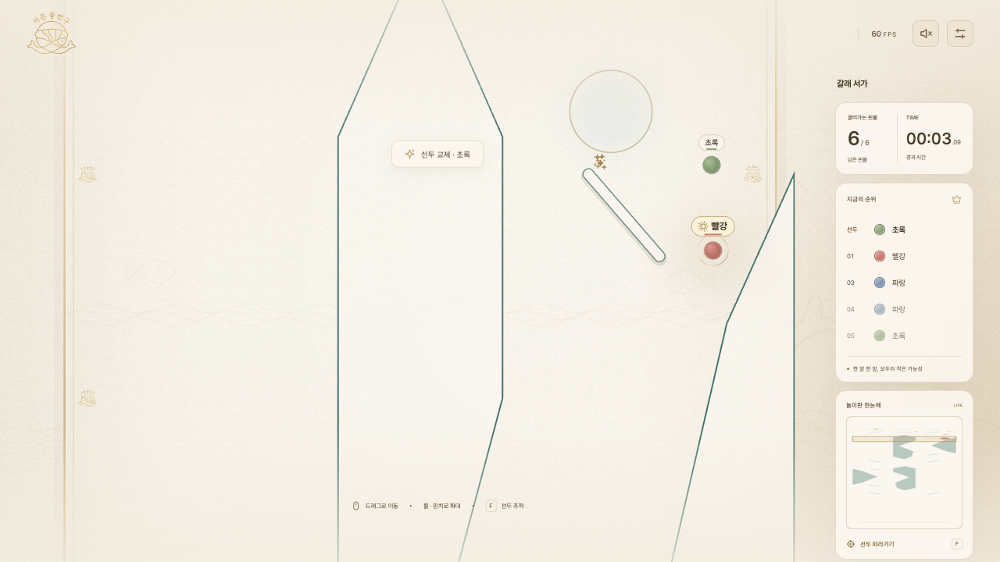
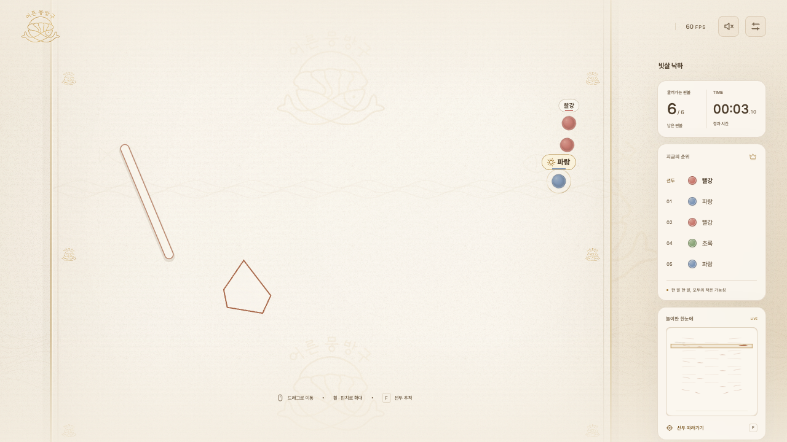
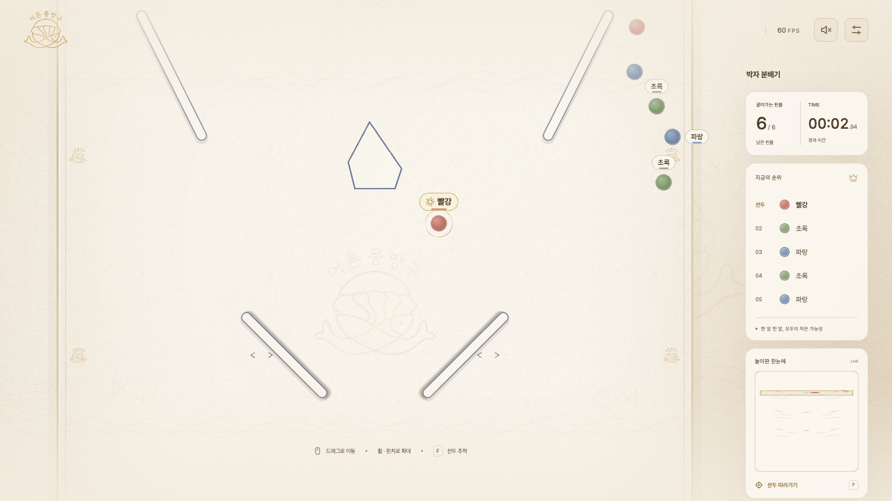
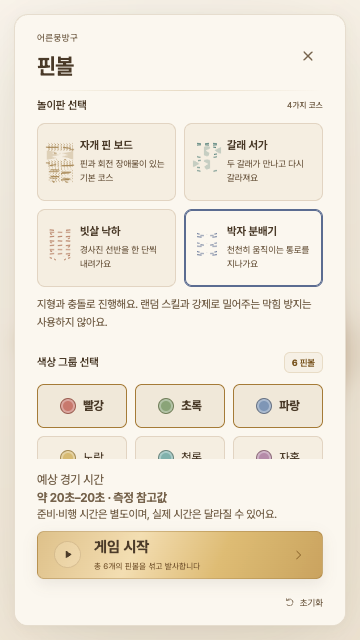

> **이 문서는 이전 기준 브랜치의 검증 기록입니다.** 원형 셔플과 v2 출발 기능이 누락된 상태를 검사했으므로 현재 통합본의 기능 보존 근거로 사용하지 않습니다. 복원 후 결과는 [REINTEGRATION.md](REINTEGRATION.md)를 확인하세요.

# 신규 맵 3종 구현·로컬 검증 보고서

2026-10-13 · 브랜치 `codex/four-maps-local` · 원격 push, PR, main 병합, 외부 배포 없음. 배포 워크플로와 운영 설정 변경 없음.

기본 자개 핀 보드를 포함해 4개 맵의 선택, Canvas 렌더링, 충돌 지형, 미니맵, 저장, 실제 출발 기록 재현, HUD·결과 표시를 연결했다. 구현과 아래 범위의 로컬 검증을 마쳤다. 시간 목표 및 엄격한 공정성 편차 기준은 미달하므로 고객 검수 시 아래 한계를 함께 검토해야 한다.

## 참고 자료와 구현

| ZIP 원본 | 맵 | 실제 구현 |
|---|---|---|
| `stitch-exports/twinfold.zip` | 갈래 서가 / twinfold | #3E716B, 다각형 섬 4개와 가이드로 길이가 다른 두 경로를 두 차례 분기·합류. 두 번째는 좌우 반전. 중앙 직통로 차단 |
| `stitch-exports/cascade.zip` | 빗살 낙하 / cascade | #A76546, 6단×3개 선반 총 18개. 실제 충돌 선분 ±30°, 열린 끝과 측면 복귀 가이드 |
| `stitch-exports/rhythm.zip` | 박자 분배기 / rhythm | #5B6C91, y2400/4800/7000의 짝 막대 3쌍. x330/670, 길이160, thickness8, ±45°, 진폭55, 속도0.8rad/s, 모듈 위상0/2π/3/4π/3 |

ZIP의 HTML과 PNG를 확인해 색과 질감을 참고했다. 압축된 시안 좌표나 페이지 전체를 복사하지 않고 기존 종이·금박 Canvas 표현을 확장했다. 움직임 범위와 방향은 정지 화면 및 화면 효과 줄이기 상태에서도 표시한다. 신규 맵의 마지막 y8800~11000은 장애물 없는 넓은 구간이다.

`js/map-registry.js`에 표시 메타데이터와 정책을 분리하고, `js/maps/{id}.js`, `{id}-style.js`에 각 지형과 전용 스타일을 둔다. 기존 `js/maps.js`의 기본 지형은 유지한다. 신규 맵에서 스킬 및 힘을 더하는 막힘 방지는 물리 계층에서도 차단한다. 미등록 ID는 기본 맵으로 복귀한다. `js/maps-duration-data.js`는 맵별 실제 측정 162행(각 조건 2시드)의 안내 표본이다. 소표본 p95는 두 값의 최댓값이며 정밀한 모집단 추정이 아니다. 지형 버전이 다른 표본은 사용하지 않는다.

## 기획 대비 조정

- 갈래 서가: 초기 B 개발 표본에서 그룹 편향 신호가 있어 진입 가이드 2개를 두 줄의 짧은 가이드 6개(y920/1220)로 변경했다(v2). 이후 독립적인 기하 검사에서 굽이·합류 간격46/61/90을 발견해 막대를 이동·축소했다(v3). 현재 장애물 사이 최소106, 벽 통로96 이상이다.
- 빗살 낙하: 진입 가이드 x100/900의 벽 간격56을 x140/860으로 이동해96으로 확대했다(v2). 선반 ±30°와 18개 구성은 유지했다. 장애물 사이 최소101.675 이상이다.
- 박자 분배기: 초안의 이동 수치를 유지했다(v1). 전체 주기 961시점의 장애물·벽 간격을 검사했으며 장애물 사이 최소100.862 이상, 벽 통로96 이상이다. 연속시간 모든 실수 시점의 형식적 증명은 아니다.
- 실제 통과 간격, 열린 출구, 마지막20% 원칙을 우선했다. 완주 시간을 늘리기 위한 강제 지연·속도·순위 보정은 넣지 않았다. 세 맵 모두 초안 시간 목표보다 짧다.

## 완료한 검증

기준 상태 테스트202개 통과 → 최종 전체 테스트 **217개 통과, 실패0**. 최종 로그는 `qa/four-maps/results/final-tests.txt`에 보관했다. 신규 폴더 도입으로 발생했던 offline 테스트의 EISDIR는 JS 파일 재귀 열거로 수정한 뒤 전체를 재실행했다.

기본 맵의 기하 해시와 B/C/D 실제 출발 기록 3건의 순위·도착 시간을 기준 fixture와 정확히 비교했다. 4개 맵의 선택·저장·복원·재시작·직전 재현, 다른 맵 선택 시 출발 기록 해제, 준비·경기 선택 잠금, 4종 추첨과 중도 정지, 저화질·효과 줄이기·프레임 간격 변경 시 재현 일치, 미등록 ID 복귀를 검증했다.

각 신규 맵마다 1/2/6/50/200/500개 × 기본값 및 radius8/16·gravity350/1500·restitution.35/.92의 8개 모서리 조합 × 2시드 =108건, 실제 B/C/D 손 출발 기록18건 및 재현을 수행했다. **각 맵 실패0**. 240 물리초 타임아웃을 제외하지 않았고, 누락·중복·비정상 좌표·벽 이탈·관통·금지 힘 이벤트를 검사했다. 표본 밖 전원 완주를 보장하는 결과는 아니다.

| 맵 | 200개 기본값 5회 완주 시간 | 초안 목표 | 200개 step p95 범위 | 500개 step p95 범위 |
|---|---:|---:|---:|---:|
| 기본 | 이번 변경의 시간 목표 없음 | 기존 유지 | 0.251–0.266ms | 0.665–0.677ms |
| 갈래 서가 v3 | 21.475–23.825초 | 30–50초: 미달 | 0.231–0.236ms | 0.616–0.633ms |
| 빗살 낙하 v2 | 26.042–30.408초 | 40–65초: 미달 | 0.225–0.265ms | 0.619–0.665ms |
| 박자 분배기 v1 | 23.875–25.367초 | 35–60초: 미달 | 0.227–0.244ms | 0.603–0.792ms |

시간은 반지름12/중력620/반발력.72, 속도1×, 준비·발사 제외. 성능은 다른 QA 종료 후 같은 장비에서 각 맵·개수별5회 직렬 실행한 물리 step p95의 범위이며 브라우저 프레임 시간이 아니다. 측정 환경·시드·각 표본은 [summary.json](summary.json)에 포함했다.

Chromium에서 4개 맵 모두 실제 마우스 붓기·드래그 발사부터 결과까지 실행하고 재현을 비교했다. 폭360/390/768/1280/1920에서 가로 넘침 없이 레이아웃·입력을 확인했다. 작은 폭은 터치 에뮬레이션이며 **실물 휴대폰 검증은 하지 않았다**. 신규 맵200/500개 각각 발사 후6초 관측에서 고화질60FPS였으나 전 경기·모든 장비 성능 보장은 아니다.

## 편향 점검과 남은 한계

실행 전 [PLAN.md](../../qa/four-maps/PLAN.md)에 개발40회/프로토콜, 최종300회/프로토콜, p≥.01 및 기존1.5%p 편차 기준을 명시했다. B=추가 섞기 없음, C=2초 원형 섞기, D=시드 기반 다양한 제스처. 최종은 신규 맵당900회, 총2700회이며 6개 구슬·3그룹 각2개·첫 당첨자 기준이다. ID/그룹/출발 슬롯별 횟수와 Wilson95% 구간을 저장했다.

| 최종 맵 | B ID / 그룹 p | C ID / 그룹 p | D ID / 그룹 p | 완료 실패 |
|---|---|---|---|---:|
| 갈래 서가 v3 | .203 / .395 | .596 / .595 | .295 / .468 | 0 |
| 빗살 낙하 v2 | .051 / .160 | .620 / .733 | .291 / .093 | 0 |
| 박자 분배기 v1 | .058 / .101 | .663 / .827 | .436 / .134 | 0 |

현재 최종 표본의 ID·그룹 p≥.01 탐색 기준은 통과했으나 **엄격한 최대 편차1.5%p 기준은 충족하지 못했다**. ID 최대 편차는3~6%p, 그룹은1.667~5.667%p였다. 300회는 1.5%p 동등성을 인증하기에 부족하다. 출발 슬롯은 균일분포를 합격 조건으로 가정하지 않고 관측치로 보고한다. 불균등 그룹·500개·모든 추첨 규칙의 공정성은 인증하지 않았다.

갈래 서가 v1 개발 B 그룹 p=.00050, v2 최종 D 그룹 p=.00255의 경고도 보존했다. v3 수정은 별도의 간격 기준 위반에 대한 것이며 기존 최종 시드를 재사용하지 않고 사전 명시한 새 버전 시드로 확인했다. 빗살 낙하 v1 결과도 보존했다. 원시 결과는 `qa/four-maps/results/`에 남아 있고 Git에서는 제외한다. 현재 버전 집계·구간·슬롯·브라우저 결과·성능은 커밋되는 summary.json에 포함한다.

## 실제 실행 화면







## Git 보존 및 목적별 커밋

시작 브랜치 `release-check/fairness-fix`, HEAD `78b23b4baf73a6b58203185c9a610c4443f4dc43`. 기준 커밋 `8362f84756a7083ce0d1f0201735563ec78adde1`에 기존 필요한 소스·테스트를 별도 보존했다. 기존 수정 `qa/fairness/freeze.cjs`(이전 감사 관리), 미추적 `qa/fairness/results/confirm.json` 및 `.json.gz`(기존 대용량 결과)는 포함하지 않고 원본 유지했다. ZIP은 기존 ignore 규칙에 따라 원본 유지했다. stash/reset/clean/amend/이력 재작성은 하지 않았다.

| SHA | 목적 | 검증 |
|---|---|---|
| 8362f84 | A. 기존 작업 기준점 | 기존202 테스트 통과 |
| e14df5e | B. 등록·선택·정책·저장 | 기본 지형·기록 회귀, fallback·정책 테스트 |
| 4d95aa4 | 선택 위치·스크립트 캐시 보완 | 브라우저 설정 화면 |
| 3f15473 | 맵별 import를 구현 커밋으로 분리 | 로딩 순서 확인 |
| 1ff7b0a | C. 갈래 서가 | 전용 형상·완주·재현 테스트 |
| f776499 | D. 빗살 낙하 | 전용 형상·완주·재현 테스트 |
| 69bce13 | E. 박자 분배기 | 전용 형상·완주·재현·이동 주기 테스트 |
| 18791a3 | 갈래 서가 진입 분산 | 개발 표본 및 해당 맵 재검증 |
| c21fdc0 | 모든 장애물·벽 간격 검사 | 좁은 통로를 발견해 아래 수정으로 해결 |
| c84551f | 갈래 서가 통로 확대 | v3 108조건+18손 기록, 새 최종 표본 |
| 0a83421 | 빗살 낙하 벽 간격 확대 | v2 108조건+18손 기록, 새 최종 표본 |
| 최종 보고 시 제공 | F. 통합 검증·시간 표본·표시 보완·문서 | 전체217 통과, 브라우저 및 직렬 성능 확인 |

마지막 행의 정확한 SHA는 커밋 자신을 파일에 넣을 수 없으므로 완료 응답에서 제공한다. `git log -1 --format='%h %s'`로도 확인할 수 있다.

## 로컬 실행 및 검사 명령

현재 미리보기: http://127.0.0.1:8765/ (루프백 전용). 이미 서버가 실행 중이면 재실행할 필요가 없다.

```sh
cd /Users/proudchris/Desktop/moonbangoo_PinBall
python3 -B -m http.server 8765 --bind 127.0.0.1
```

직접 실행한 서버는 터미널에서 Ctrl+C로 종료한다. 이번 세션 서버 PID는82502이며 종료 전 `lsof -nP -iTCP:8765 -sTCP:LISTEN`으로 본 서버인지 확인한다. 서버 종료 후 필요할 때 위 명령으로 재실행한다.

완료된 검사를 다시 실행할 필요는 없다. 변경 후 재검증할 때:

```sh
npm test
node qa/four-maps/run-map.cjs twinfold
node qa/four-maps/run-map.cjs cascade
node qa/four-maps/run-map.cjs rhythm
node qa/four-maps/fairness.cjs final twinfold
node qa/four-maps/fairness.cjs final cascade
node qa/four-maps/fairness.cjs final rhythm
node qa/four-maps/browser.cjs
node qa/four-maps/performance.cjs
```

브라우저 검사는 프로젝트의 Playwright와 로컬 Chrome을 사용한다. 재실행은 같은 이름의 원시 결과를 덮어쓰므로 이전 결과를 보존한 뒤 실행한다. 최종 시드는 지형 튜닝용으로 재사용하지 않는다.
